<div align="center">
  
  <br/>
  <br/>

<p align="center">
  <a href="https://github.com/arcsin1/oh-my-ppt" target="_blank">
    
  </a>
  <a href="https://github.com/arcsin1/oh-my-ppt/releases" target="_blank">
    
  </a>
  <a href="#features">
    
  </a>
  <a href="./LICENSE" target="_blank">
    
  </a>
  <a href="https://www.electronjs.org/" target="_blank">
    
  </a>
</p>

**Oh My PPT - Local-first AI Slide Deck, Image Generation & Editing Workbench**

[中文](./README.md) | [日本語](./README_JA.md) | [New in v3.0](#v3) • [Why](#why) • [Features](#features) • [Workflow](#workflow) • [Changelog](./CHANGELOG.md) • [Usage Notes](#usage-notes)

  <p>
    AI-powered editable HTML, reinventing how next-generation presentations are made.<br/>
    Describe what you want to say and let AI shape the outline, slides, and visuals.<br/>
    Create, edit, present, and export in one local-first workflow.<br/>
    Local-first · Your models, your workflow.
  </p>

  [Website](https://www.ohmyppt.cc) | [Download](https://github.com/arcsin1/oh-my-ppt/releases)

</div>

---

<a id="sponsors-list"></a>
## 🏢 Sponsors

<table>
  <tr>
    <th width="260">Sponsor</th>
    <th>About</th>
  </tr>
  <tr>
    <td width="260" align="center" valign="middle"><a href="https://www.toumingren.xyz/" target="_blank">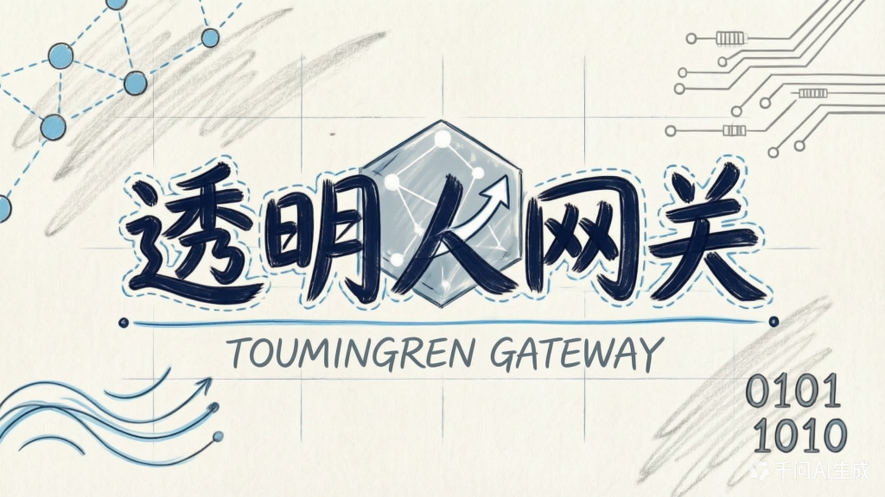</a></td>
    <td valign="middle">❤️ 感谢 <b><a href="https://www.toumingren.xyz/">透明人网关</a></b> 对 Oh My PPT 的赞助支持！<br/>高性价比 AI 聚合 API 网关——一套接口、一个 Key，海内外主流大模型一键通调！<br/>💥 <b>王牌底价</b><br/>🖼️ 生图单张低至 3 分钱！<br/>✅ GLM & DeepSeek 官方原版，价格直接砍半<br/>✅ 国模特惠分组，倍率低至 0.1，批量跑量成本拉满低<br/>✅ 高缓存命中率，重复请求更省 Token<br/>🧠 <b>支持模型能力</b><br/>文本：GPT、Claude、Gemini、DeepSeek、GLM，文案撰写、代码开发、方案脑暴、PPT 生成全都 hold 住<br/>图像：GPT-Image、Gemini，文生图、图编轻松调用<br/>⚙️ <b>接入省心</b>：线路稳定高速，兼容 OpenAI 格式，仅改一行 base_url 即可接入<br/>🎁 <b>长期惊喜福利</b>：不定时限时活动，充值直送余额；重大节日加码专属好礼，蹲优惠不踩空！<br/>无虚标、不混降级模型，开发者、工作室、批量业务调用首选！</td>
  </tr>
  <tr>
    <td width="260" align="center" valign="middle"><a href="https://www.aiyoyoo.com/register?aff=PQP2BB2SSRVB" target="_blank">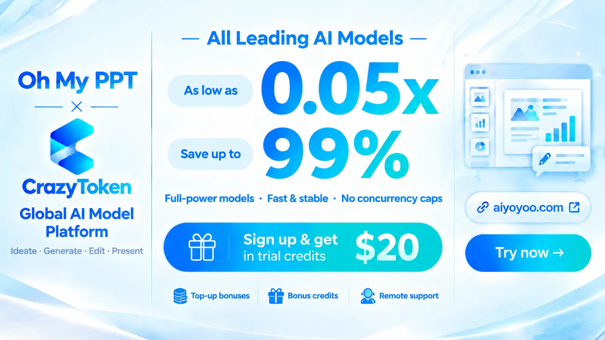</a></td>
    <td valign="middle">❤️ Thank you to <b><a href="https://www.aiyoyoo.com/register?aff=PQP2BB2SSRVB">CrazyToken</a></b> for sponsoring <b>Oh My PPT</b>!<br/>CrazyToken provides APIs for <b>Claude, GPT, Gemini, Kimi, GLM, DeepSeek, Qwen, Grok</b>, and other leading models for brainstorming, outlining, HTML slide generation, and conversational editing. Choose the right model to take your ideas from concept to presentation.<br/>💰 <b>As low as <code>0.05×</code></b>: Save up to 99%, with transparent token-level billing.<br/>✨ <b>Official model access</b>: Native performance with no model substitution or long-context compression.<br/>⚡ <b>Fast, stable, and no concurrency caps</b>: Keep presentation generation and multiple rounds of revisions flowing.<br/>🎁 <b><code>$20</code> signup gift for new users</b>: Register through the <a href="https://www.aiyoyoo.com/register?aff=PQP2BB2SSRVB">exclusive link</a> to receive trial credits, plus top-up bonuses and <b>one-on-one remote setup assistance</b> from a real person.</td>
  </tr>
  <tr>
    <td width="260" align="center" valign="middle"><a href="https://mixtoken.ai/?code=GWZQRH" target="_blank">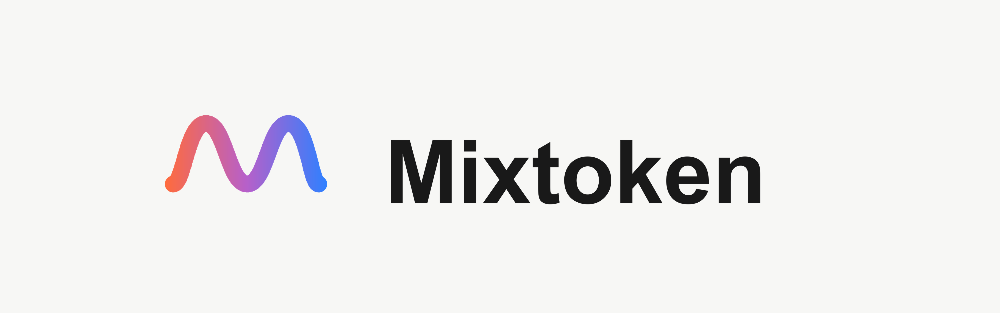</a></td>
    <td valign="middle">❤️ 感谢 <b><a href="https://mixtoken.ai/?code=GWZQRH">Mixtoken</a></b> 对 Oh My PPT 的赞助支持！<br/>一站式接入主流 AI 模型 API，覆盖文本生成、图片创作与视频制作。一个 Key 调用所有模型！稳定高速，不掺水！<br/>🧠 语言模型：Claude、GPT、Gemini、DeepSeek 等，支持文案写作、代码开发和演示稿内容生成。<br/>🖼️ 图片模型：GPT-Image、Gemini 等，支持图片生成与编辑。<br/>🎥 视频模型：Seedance、MiniMax Hailuo H3、Grok 等，支持视频生成。<br/>✨ 新人体验：通过<a href="https://mixtoken.ai/?code=GWZQRH">专属链接</a>注册即可领取体验额度，测试模型效果。接入或使用中遇到问题，可联系人工客服。<br/>🌐 企业运营：由海外企业运营，具备企业资质，支持开具正规发票。</td>
  </tr>
</table>

<a id="sponsors"></a>
## 💖 Backers

Thanks to everyone who has supported Oh My PPT — see [SponsorsList.md](./SponsorsList.md) for the full list.

---

<div>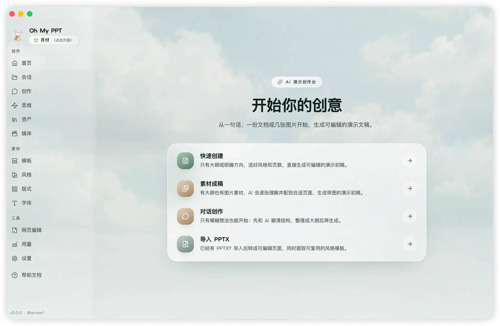</div>

## Table of Contents

- [Sponsors](#sponsors-list)
- [Backers](#sponsors)
- [New in v3.0](#v3)
- [Why I Built This](#why)
- [Import Legacy PPTX Templates for Editing](#pptx-import)
- [Export Editable PPTX from the Desktop App](#pptx-export)
- [What It Can Do](#features)
- [Workflow](#workflow)
- [100+ Built-in Styles & Style Management](#style-skills)
- [AI Image Generation & Smart Visuals](#image-generation)
- [Font Management](#fonts)
- [Animation Support](#animations)
- [Local Ollama Support](#ollama)
- [Usage Notes](#usage-notes)
  - [Configure your models first](#config)
  - [About preview mode](#preview)
  - [About export](#export)
- [Opening Unsigned Apps](#unsigned-app)
- [Reference](#references)
- [Contributors](#contributors)
- [License](#license)

---

<a id="v3"></a>
## 🚀 New in v3.0

A rebuilt workspace, 176 reusable layouts, style management, asset-to-deck creation, and a media workspace — all in place. Layouts, styles, assets, and media come together in one workspace.

|  | 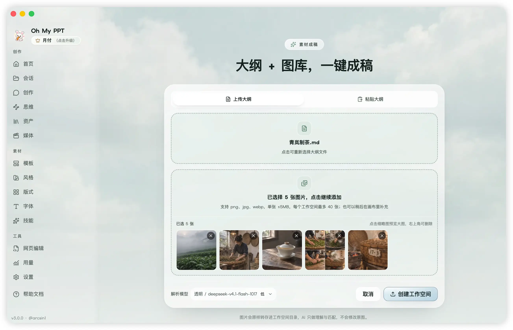 |
| --- | --- |
| **🪟 New Start Screen** — Quick create, asset-to-deck, chat creation, and PPTX import — four ways in, all in one place. | **🖼️ Asset-to-Deck** — Upload an outline and image assets — AI reads each page and builds an illustrated first draft. |
| 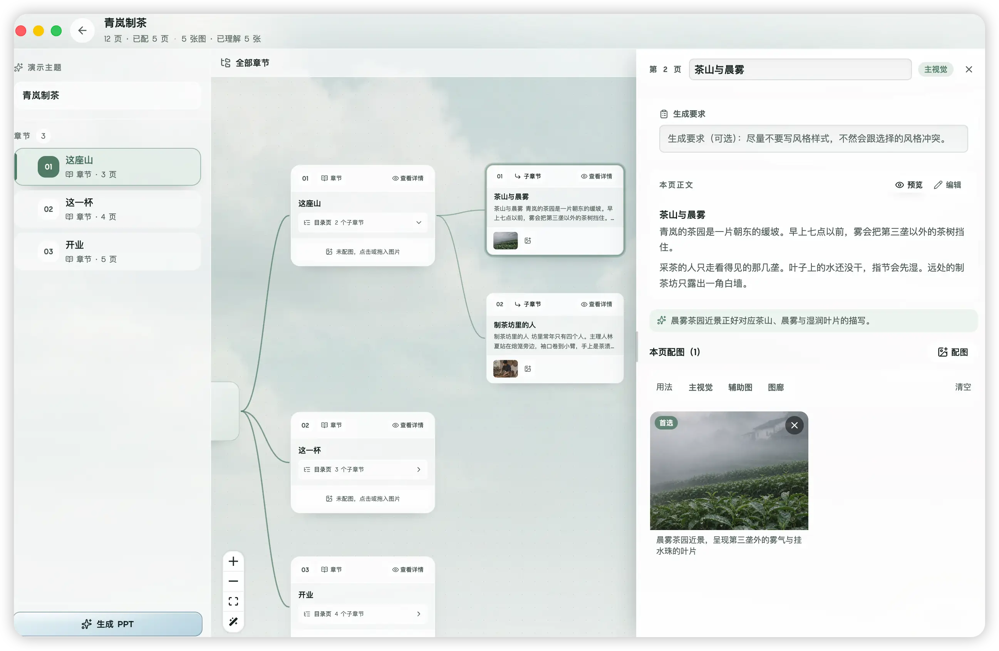 | 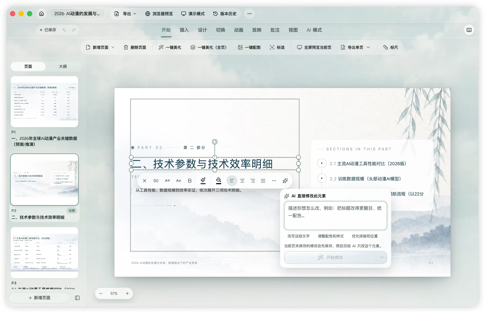 |
| **🗺️ Outline & Visuals** — Chapter outline, source materials, and per-page image matching side by side. | **✨ Visual Editing** — Select any element and ask AI to rewrite the copy, colors, or layout in place. |
| 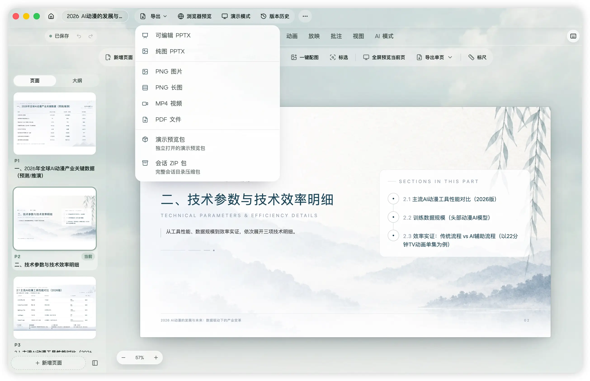 | 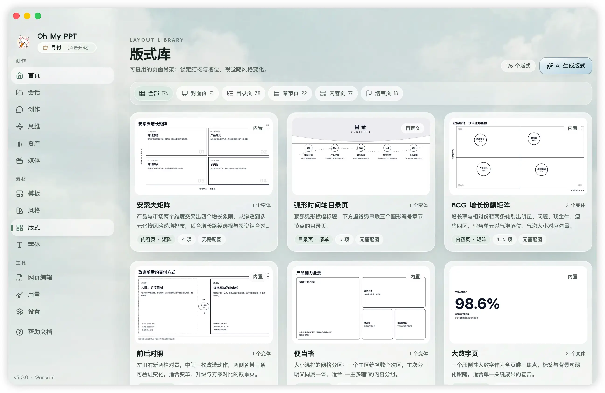 |
| **📤 Multi-Format Export** — Editable PPTX, image-based PPTX, PNG, MP4, and PDF from one menu. | **🧱 Layout Library** — 176 reusable page skeletons, filterable by cover, contents, section, content, and closing. |
| 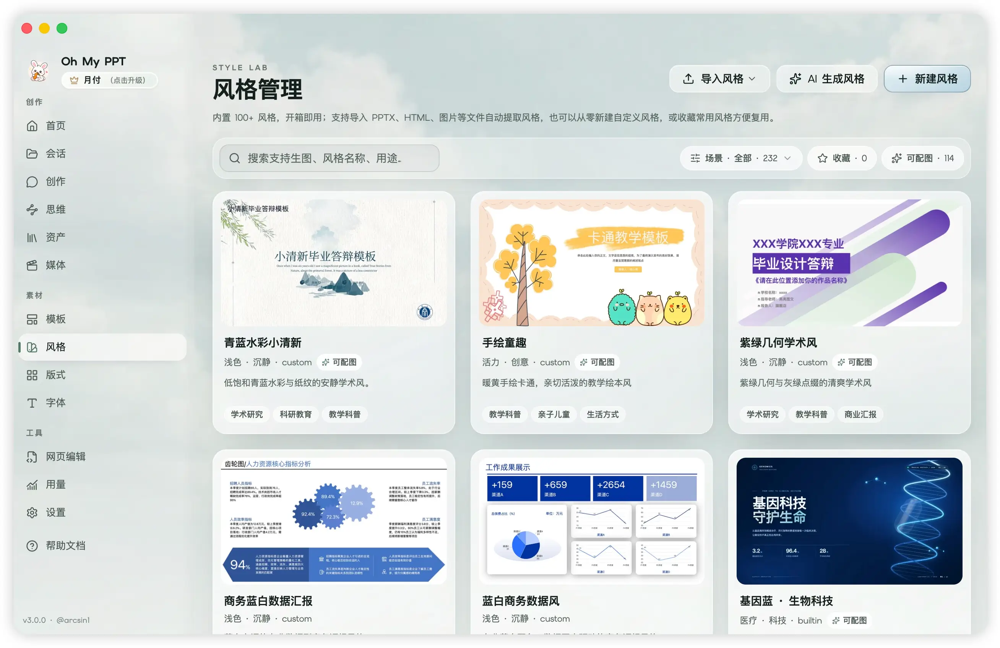 | 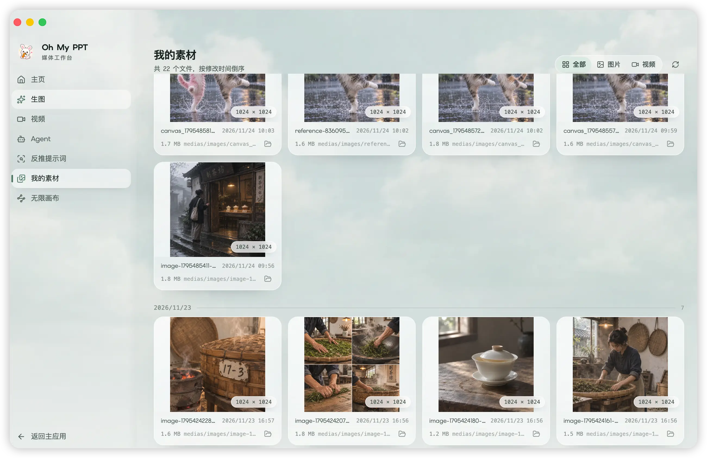 |
| **🎨 Style Manager** — 100+ built-in styles, extract new ones from PPTX, HTML, or images, and favorite the ones you reuse. | **📽️ Media Workspace** — Generated images, videos, and assets organized in one place, ready to reuse. |

<a id="why"></a>
## 🎯 Why I Built This

**Making AI-powered HTML presentations possible.**

Every time I needed to prepare a talk, report, pitch, or defense, most of the time went into layout tweaks.

There are many AI PPT tools, but most output fixed-format files. Fine-tuning styles or adding custom animation demos is still painful.

So I built my own HTML-based PPT generator, originally as a personal tool.

Output is pure HTML slides: instant browser preview, no extra software, easy to tweak styles, add motion, embed code, and export to PDF / PNG / editable PPTX.

<a id="pptx-import"></a>
## 📥 Import Legacy PPTX Templates for Editing, Close to 100% Fidelity

Bring existing PPTX templates, past reports, or client files into the desktop app and keep editing. Typical PPTX imports restore close to **100%** of the original visual and structural result, converting files into pages you can drag, adjust, modify with AI, and manage through version history. Imported files can also yield reusable styles for future work.

Parsing and structured conversion are **fully in-house**; complex shapes, charts, tables, and animations continue to improve, and fidelity varies with the source file's features, fonts, and asset complexity.

<a id="pptx-export"></a>
## 📤 Export Editable PPTX from the Desktop App, Close to 100% Fidelity

After creating or editing in the desktop app, export a true PPTX that remains editable in PowerPoint / Keynote. In typical cases, the exported file preserves close to **100%** of its visual and structural result, including text, images, colors, formulas, and basic layout where possible. An **image-based PPTX** is also available when you want a layout that absolutely cannot shift.

HTML-to-editable-PPTX generation and layout are **fully in-house**; complex charts, tables, shapes, and animations are still being improved.

<a id="features"></a>
## ✅ What It Can Do

- 🧭 **All-new v3.0 workspace** — The start screen offers four ways in: Quick Create, Assets to Deck, Chat Creation, and Import PPTX; templates, styles, layouts, fonts, and media live in one sidebar, with assets, usage stats, and HTML editing close at hand
- 🖼️ **Asset-to-Deck** — Upload an outline and image assets together; AI reads each image, matches it to the right page by meaning, and builds an illustrated first draft
- 🗺️ **Outline & visuals side by side** — Chapter outline, source materials, and per-page image matching are arranged in one space, so every text-image pairing is clear before generation
- 🧱 **Layout library** — 176 reusable page skeletons, filterable by cover, contents, section, content, and closing; swap any page's layout with one click while keeping its text intact
- 📽️ **Media workspace** — Generated images, videos, and assets organized in one place, ready to reuse
- 🎨 **100+ built-in styles & style management** — Minimal White, Cyber Neon, Bauhaus, Japanese Minimal, Xiaohongshu White, and more; extract styles from PPTX, HTML, or images, favorite the ones you reuse, or bring your own
- 📥 **Import legacy PPTX templates for editing, close to 100% fidelity** — Imported files become pages you can drag, adjust, modify with AI, and manage through version history; parsing and conversion are fully in-house
- 📤 **Export editable PPTX from the desktop app, close to 100% fidelity** — Export decks as true PPTX files that remain editable in PowerPoint / Keynote; generation and layout are fully in-house
- ⚡ **Quick Create** — Paste Markdown / plain text or upload Word, PDF, and Excel files; after parsing you land on the chapter canvas to confirm style, layouts, and page count before generating
- 💬 **Chat Creation** — Start from a vague idea: talk through the topic, audience, and structure with AI, shape the outline, then generate
- 🔀 **Multi-task generation** — Submit multiple generation tasks in parallel without waiting for one to finish before starting another, with automatic notifications on completion
- 📐 **Multi-size, multi-format canvases** — 16:9, 4:3, vertical 9:16, portrait 3:4, square 1:1, Xiaohongshu/social-note formats and more, with the real aspect ratio preserved from generation to export
- 🌐 **HTML editing** — Import a single HTML file to edit and save it in the app, with AI edits, asset insertion, history, preview, and export
- 🧱 **Template library and template creation** — Save generated or edited decks as templates, import PPTX files as templates, and reuse templates to create new PPT sessions
- 🖼️ **AI image generation and smart visuals** — Enable automatic visuals while creating a deck. AI generates illustrations, backgrounds, and visual assets only where the current content, layout, and chosen style call for them, instead of forcing an image onto every slide
- ✨ **In-editor image studio** — Generate a prompt from the current slide title and outline, add your own direction and image size, then preview the result, add it to the canvas, or make it the slide background
- 🔒 **Local-first** — Sessions, source documents, assets, and generated results stay on your computer. No Oh My PPT account or platform cloud is required. Requests made to your configured AI or image service are sent to that provider
- 🔤 **Font management** — 14 curated Google Fonts built-in (including CJK), upload local fonts, pick title and body fonts separately or let AI auto-match
- ✏️ **Chat-based editing** — Tell it "change title color" or "add a data chart" on a specific page, without rebuilding everything; select any element and let AI change just that piece
- 🖱️ **Visual editing** — Every visible element can be dragged and resized, double-click text to edit inline; the toolbar adds page insert/delete, one-click beautify, and one-click visuals
- 📸 **Image and video insertion** — Upload images and videos directly in edit mode from the asset library or local files, and use them alongside AI-generated images
- 📋 **Element duplication** — One-click copy of any element (text, images, videos, etc.), auto-offset and independently editable
- ↩️ **Undo and redo** — Undo and redo edits freely before committing, then save as a version history entry
- 🗑️ **Element deletion** — Delete any element with a click or keyboard shortcut
- 🖥️ **Presentation mode** — Enter fullscreen presentation with one click, navigate slides with arrow keys or clicks
- 📝 **Speaker script generation** — Generate scripts for the full deck or the current slide, with formal, casual conversational, storytelling, and custom styles
- 🎬 **Animation support** — 16+ slide transition effects plus 38 element animation types (powered by a local Anime.js v4 runtime), also supported in exported PPTX
- 🎞️ **Per-element animation controls** — Select individual text, image, chart, or other elements while editing, then configure entrance, emphasis, or exit effects with automatic/click triggers, duration, and direction
- 🧮 **Math formula rendering** — Display common LaTeX formulas for classes, teaching decks, and technical talks
- 📄 **Multi-format export** — Editable PPTX, image-based PPTX, PNG, PNG long image, PDF, and MP4 from one menu, plus session ZIP backups and standalone presentation preview packages
- 🏷️ **Session management** — Session list distinguishes AI-created decks from imported PPTX decks, and deck names can be renamed; sessions are health-checked before opening, so no more blank pages
- 🧩 **More reliable page layout** — Generation follows the selected canvas size and content-height budget to reduce overflow
- 🔄 **Version history rollback** — Every edit is automatically saved, roll back to any previous version with one click, never worry about mistakes
- 📊 **Usage statistics** — Token consumption is transparent per step of each generation and edit
- 💾 **Session import & export** — Export a session ZIP from the editor and import it on another computer to continue editing; the presentation preview package opens in a browser with a double click, for seamless cross-device collaboration

<p>
  
  
  
</p>

<a id="workflow"></a>
## 🔄 Workflow

> 💡 Once your model is configured, pick one of the four creation entry points → confirm the chapter outline, style, layouts, and page count (Assets to Deck also takes image uploads) → AI generates editable HTML slides page by page → preview, present, visually edit, and chat to refine → export an editable PPTX with close to 100% fidelity, or image-based PPTX / PDF / PNG / MP4 / session ZIP.


The home page offers four creation entry points — pick whichever matches what you already have:

- **Quick Create** (outline or clear direction ready): paste Markdown / plain text or upload Word, PDF, and Excel files; after parsing you land on the chapter canvas to confirm style, layouts, and page count before generating.
- **Assets to Deck** (outline plus images): upload an outline and image assets together; AI reads each image and matches it to the right page by meaning, producing an illustrated first draft. In the workspace you can review how each image was understood and fine-tune the text-image pairings.
- **Chat Creation** (just an idea): talk through the topic, audience, and structure with AI first, shape the outline, then generate — useful when requirements are still unclear, the material is complex, or you want to refine the outline together first.
- **Import PPTX** (files you already have): convert existing PPTX files into editable pages while extracting their styles and layouts, restored with close to 100% fidelity for further editing.

Saved templates, styles, layouts, and fonts can all be reused in new work. You can leave the page while generation runs — tasks continue in the background and notify you when done. After generation, keep editing in the editor (drag elements, insert images/videos, chat edits, roll back history, generate speaker scripts) and export an editable PPTX with close to 100% fidelity or other formats.

<a id="style-skills"></a>
## 🎨 100+ Built-in Styles & Style Management

100+ styles are built in: Minimal White, Cyber Neon, Bauhaus, Japanese Minimal, Xiaohongshu White, and more — favorite the ones you reach for often. Since v3.0 you can extract styles from PPTX, HTML, and images to build a library of your own; you can also upload a screenshot or design mockup and let AI extract its visual signature into a distinctive style and outline (requires a multimodal AI model).

To create your own Style Skill, use the official style generation package: [arcsin1/style-generate-skill](https://github.com/arcsin1/style-generate-skill). It helps turn reference designs, palettes, and layout requirements into importable Oh My PPT style packages.


<a id="image-generation"></a>
## 🖼️ AI Image Generation & Smart Visuals

Image generation has two entry points for deck-wide visuals and targeted additions:

| Use case | How to use it | Result |
| --- | --- | --- |
| Create a full deck | Add an image endpoint under **Settings → Image Models** and **test-generate an image**; enable **Image Generation** on the creation page and pick a style marked **Image generation** | AI produces illustrations, backgrounds, or visual elements only in suitable layout slots, preserving text-safe space and the selected visual style |
| Edit an existing slide | Open the editor's image-generation panel, generate a prompt from the current slide or write one yourself, then choose a model and size | Preview the generated image, add it to the canvas for layout work, or set it as the current slide background |

Built-in provider presets include Jimeng 3.0 / 4.0, Agnes AI, Seedream, SiliconFlow, Gemini, and OpenAI-compatible image APIs; text and image models are configured separately, and an image endpoint becomes available only after passing a real test under **Settings → Image Models**.

Successful outputs are archived in the media workspace and the session's local asset directory, ready to edit, replace, export, or move with the session. Automatic visuals keep the canvas format and never replace images you uploaded. Image requests are sent to the provider you choose — follow its privacy and content policies.

<a id="fonts"></a>
## 🔤 Font Management

14 curated Google Fonts are built in (including CJK families). You can also upload local `.woff2` font files and customize the font name, category (sans-serif, serif, handwriting, monospace, and more), role (title / body), and script type (Latin / CJK).

When creating a deck, you can choose **title fonts** and **body fonts** separately, or let AI automatically match the best font pair based on the topic and style. When exporting to PPTX, used fonts are automatically embedded so the deck displays consistently on other computers.

<a id="animations"></a>
## 🎬 Animation Support

Oh My PPT generates HTML slides with 16+ slide transition effects, 38 element animation types, and a local **Anime.js v4** runtime — animations are also supported in exported PPTX. During generation or chat-based editing, the AI can add presentation motion to whole slide elements such as titles, metric cards, images, chart containers, and step blocks.

In addition to AI-generated motion, edit mode lets you select an individual element and configure its entrance, emphasis, or exit effect, together with automatic or click triggering, duration, and direction.

Animations are designed for real presentation flow: content can appear step by step with the speaker's rhythm instead of showing everything on the slide at once. This works well for reports, pitches, classes, and product walkthroughs.

Common animation expressions include:

- **Fade in**: lightweight transitions when modules appear.
- **Slide-in motion**: short movement from top, bottom, left, or right for titles, cards, and lists.
- **Scale emphasis**: gently enlarge key numbers or conclusion cards, then settle back.
- **Staggered reveal**: reveal cards or bullets one after another.
- **Click-to-reveal**: reveal content step by step during presentation, so the deck follows your speaking pace.

Whole-element animation is preferred over splitting text into many tiny moving fragments. It keeps slides readable, stable, and easier to export or edit later. Animations are meant to guide attention and show hierarchy, so complex timelines, high-frequency flashing, infinite loops, and large shaking motion are not recommended.

<p>
  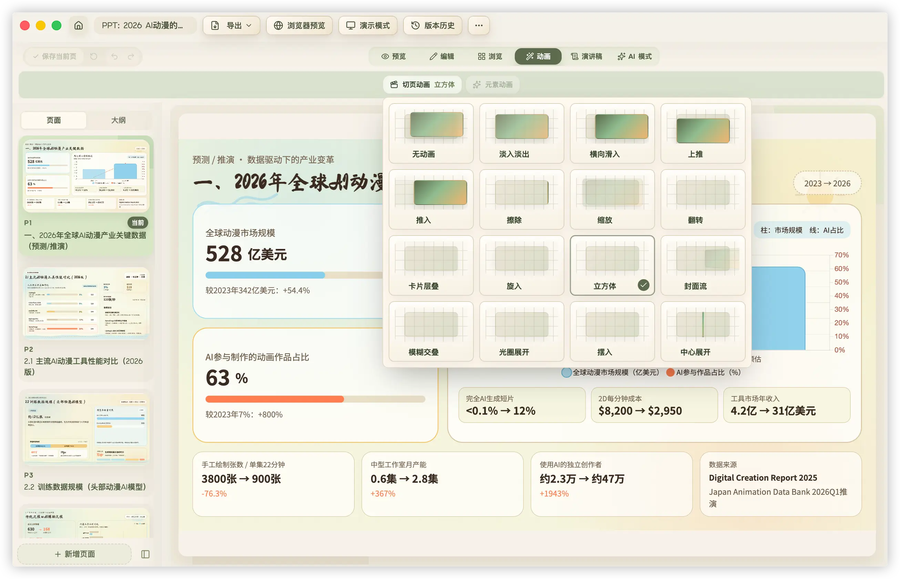
  
</p>

<a id="ollama"></a>
## 🦙 Local Ollama Support (OpenAI-Compatible)

This project supports local Ollama through the **OpenAI-compatible API**.

When adding an endpoint under **Settings → Base Model Configuration**, fill in:

- `Provider preset`: `OpenAI Compatible`
- `base_url`: `http://127.0.0.1:11434/v1`
- `Model`: enter your local model tag manually (for example `qwen2.5-coder:14b`); a 14B+ model (or a strong cloud model) is recommended
- `api_key`: any non-empty string (for example `ollama`)

Notes:

- Ollama does not validate API keys by default, but this app enforces a non-empty check, so `api_key` cannot be blank.
- 14B+ local models (or strong cloud models) are recommended for stable generation quality.
- Official OpenAI endpoints do not receive the non-standard `thinking` parameter, avoiding `400 Unknown parameter` responses. Other OpenAI-compatible `base_url` values still request disabled thinking so multi-turn tool flows do not lose `reasoning_content`.
- The Ollama setup is for text generation, document parsing, and chat editing. Configure an image-capable provider separately under **Settings → Image Models** for image generation or automatic visuals.

<a id="usage-notes"></a>
## Usage Notes

<a id="config"></a>
### Configure your models first

> Recommended: DeepSeek V4, Kimi, Doubao, Qwen, GLM, MiMo, MiniMax and other Chinese models, plus GPT, Claude and other international models.

Under **Settings → Base Model Configuration**, click **Add Endpoint**, choose a provider preset (or **Custom / Compatible Protocol** if none matches), fill in the base_url and API key, and save. Then fetch or manually add models in the model list — the first model of the first endpoint becomes the default automatically. Generation, chat editing, and document parsing all use the base model configured here; set it up once and switch models whenever needed.

For AI image generation or automatic visuals, add an image endpoint under **Settings → Image Models** and test-generate an image with each model; once the test passes, you can enable visuals on the creation page or use them in the editor and media workspace.

<a id="preview"></a>
### About preview mode

Navigate slides with the left/right arrow keys; presentation mode and fullscreen presentation mode are both supported, and `ESC` exits the presentation.

<a id="export"></a>
### About export

Everything exports from one menu:

- **Editable PPTX**: fully in-house export foundation, close to 100% fidelity in typical cases, remains editable in PowerPoint / Keynote — best for delivery and further polishing.
- **Image-based PPTX / PNG**: layouts that cannot shift, great for sharing, social posts, and archiving; PNG batch-exports every slide for docs, Notion, articles, or social content.
- **PNG long image**: stitch the full set of pages vertically into one long image for social posts, chat sharing, long-document previews, and mobile reading.
- **PDF**: best for sharing, archiving, and printing.
- **MP4**: render animated pages into a video for courses, playback, or situations where a PPT file is not the best fit.
- **Session ZIP / presentation preview package**: full backups or cross-device migration; the preview package opens and presents in a browser with a double click, no installation needed.


<a id="unsigned-app"></a>
## 📦 Opening Unsigned Apps

Release builds may not be code-signed yet, so macOS or Windows can show security warnings on first launch. This usually does not mean the app is broken; it is the operating system blocking unsigned or unnotarized software by default.

### macOS

If macOS says the app cannot be opened, is damaged, or cannot verify the developer, use either option below.

**Option 1: Right-click Open**

1. Open Finder or the Applications folder.
2. Find `OhMyPPT.app`.
3. Right-click the app and choose **Open**.
4. Click **Open** again in the confirmation dialog.

This usually only needs to be done once.

**Option 2: Clear the quarantine attribute**

If right-click Open still does not work, run:

```bash
xattr -cr /Applications/OhMyPPT.app
```

Then open the app again.

If you placed the app somewhere else, replace the path with the actual location, for example:

```bash
xattr -cr ~/Downloads/OhMyPPT.app
```

### Windows

Unsigned installers may trigger Windows SmartScreen, such as "Windows protected your PC". This is expected for unsigned apps.

Steps:

1. Click **More info**.
2. Confirm the app name is `OhMyPPT`.
3. Click **Run anyway**.

If your browser or antivirus blocks the file, first confirm the installer came from this project's GitHub Releases page, then choose to keep or allow the file.

> Download builds only from the official Releases page when possible.

<a id="references"></a>
## Reference

- [@arcsin1/pptx2json](https://www.npmjs.com/package/@arcsin1/pptx2json) — Oh My PPT's fully in-house foundation for editable PPTX import, parsing PPTX files into editable structured data. Support for complex shapes, charts, tables, animations, and more will continue to improve.
- [@arcsin1/html2pptx](https://www.npmjs.com/package/@arcsin1/html2pptx) — Oh My PPT's fully in-house foundation for editable PPTX export, converting HTML into true, editable PPTX files. Support for complex shapes, charts, tables, animations, and more will continue to improve.
- [arcsin1/style-generate-skill](https://github.com/arcsin1/style-generate-skill) — the official Oh My PPT style-generation Skill for turning reference designs, palettes, layouts, and scenario requirements into importable style packages.
- [ui-ux-pro-max-skill](https://github.com/nextlevelbuilder/ui-ux-pro-max-skill)
- [html-ppt-skill](https://github.com/lewislulu/html-ppt-skill)

<a id="contributors"></a>
## Contributors

Thanks to all contributors!

<p>
<a href="https://github.com/m13891290332"></a>
<a href="https://github.com/whisper-xiang"></a>
<a href="https://github.com/Jacobinwwey"></a>
</p>

<a id="license"></a>
## License

This project is licensed under the [Apache License 2.0](LICENSE) © 2026 arcsin1 &lt;zy19931129@gmail.com&gt;.
