<div align="center">
  
  <br/>
  <br/>

<p align="center">
  <a href="https://github.com/arcsin1/oh-my-ppt" target="_blank">
    
  </a>
  <a href="https://github.com/arcsin1/oh-my-ppt/releases" target="_blank">
    
  </a>
  <a href="#features">
    
  </a>
  <a href="./LICENSE" target="_blank">
    
  </a>
  <a href="https://www.electronjs.org/" target="_blank">
    
  </a>
</p>

**Oh My PPT - ローカルファーストの AI スライド作成・画像生成・編集ワークベンチ**

[中文](./README.md) | [English](./README_EN.md) | [v3.0 の新機能](#v3) • [なぜ作ったのか](#why) • [機能](#features) • [ワークフロー](#workflow) • [更新履歴](./CHANGELOG.md) • [使用上の注意](#usage-notes)

  <p>
    AI で動く編集可能な HTML で、次世代のプレゼンテーションの作り方を再発明します。<br/>
    伝えたいことを説明するだけで、AI がアウトライン、スライド、ビジュアルを形にします。<br/>
    作成、編集、プレゼンテーション、エクスポートまでを 1 つのローカルファーストのワークフローで行えます。<br/>
    Local-first · Your models, your workflow.
  </p>

  [ウェブサイト](https://www.ohmyppt.cc) | [ダウンロード](https://github.com/arcsin1/oh-my-ppt/releases)

</div>

---

<a id="sponsors-list"></a>
## 🏢 スポンサー

<table>
  <tr>
    <th width="260">スポンサー</th>
    <th>概要</th>
  </tr>
  <tr>
    <td width="260" align="center" valign="middle"><a href="https://www.toumingren.xyz/" target="_blank">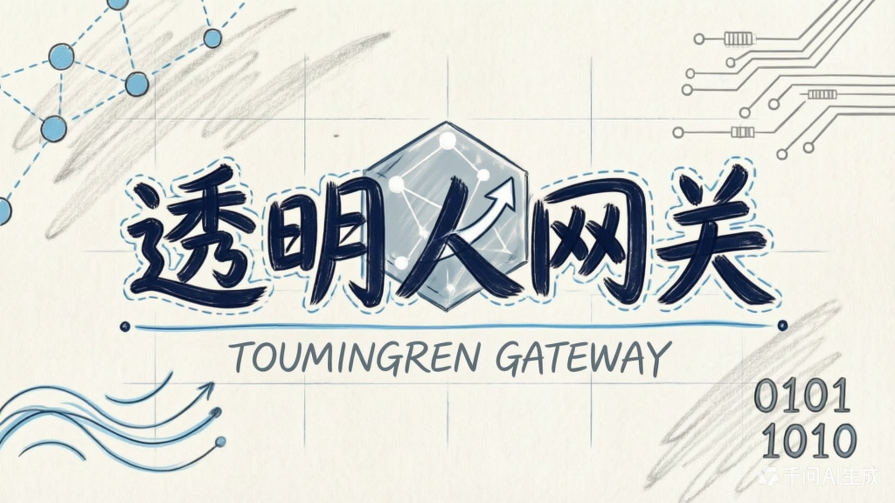</a></td>
    <td valign="middle">❤️ Oh My PPT をご支援いただいている <b><a href="https://www.toumingren.xyz/">透明人网关</a></b> に感謝します！<br/>コストパフォーマンスに優れた AI 集約 API ゲートウェイ——1 つのインターフェース、1 つの Key で、国内外の主要な大規模モデルをワンクリックで呼び出せます！<br/>💥 <b>最安クラスの価格</b><br/>🖼️ 画像生成は 1 枚わずか 3 分（0.03 元）から！<br/>✅ GLM と DeepSeek の公式オリジナル版を半額で<br/>✅ 国産モデルのお得なグループは倍率 0.1 から、大量処理のコストを最小限に<br/>✅ 高いキャッシュヒット率で、重複リクエストの Token をさらに節約<br/>🧠 <b>対応モデル</b><br/>テキスト：GPT、Claude、Gemini、DeepSeek、GLM。文章作成、コード開発、企画のブレインストーミング、PPT 生成まですべて対応<br/>画像：GPT-Image、Gemini。テキストからの画像生成や画像編集も手軽に呼び出せます<br/>⚙️ <b>導入が簡単</b>：回線は安定して高速、OpenAI 形式に互換性があり、base_url を 1 行変えるだけで接続できます<br/>🎁 <b>継続的なうれしい特典</b>：不定期の期間限定キャンペーンでチャージ額に残高を上乗せ。大型の祝日には特別なプレゼントを追加。お得な機会を逃しません！<br/>誇大表示なし、ダウングレードしたモデルの混入なし。開発者、スタジオ、大量の業務呼び出しに最適です！</td>
  </tr>
  <tr>
    <td width="260" align="center" valign="middle"><a href="https://www.aiyoyoo.com/register?aff=PQP2BB2SSRVB" target="_blank">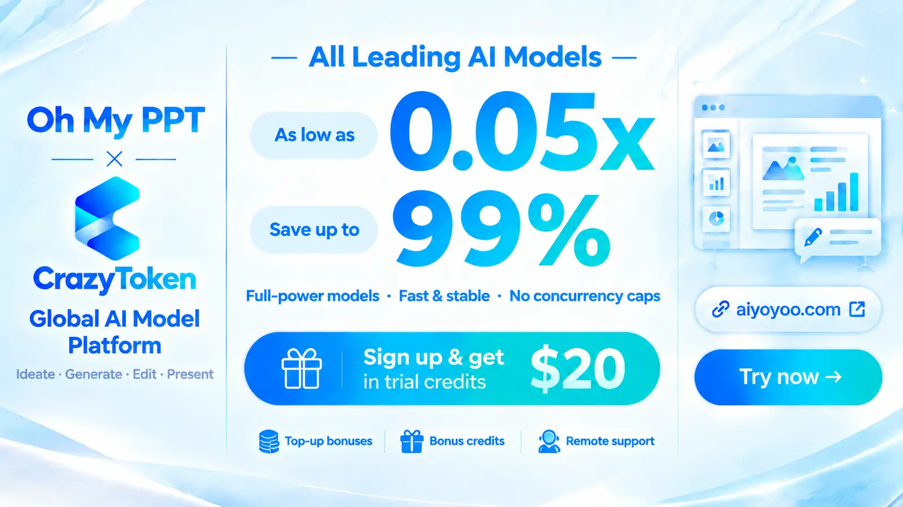</a></td>
    <td valign="middle">❤️ <b>Oh My PPT</b> をご支援いただいている <b><a href="https://www.aiyoyoo.com/register?aff=PQP2BB2SSRVB">CrazyToken</a></b> に感謝します！<br/>CrazyToken は、<b>Claude、GPT、Gemini、Kimi、GLM、DeepSeek、Qwen、Grok</b> などの主要モデルの API を提供しており、ブレインストーミング、アウトライン作成、HTML スライド生成、対話による編集に使えます。最適なモデルを選んで、アイデアを構想からプレゼンテーションへと仕上げましょう。<br/>💰 <b>最安 <code>0.05×</code></b>：最大 99% 節約でき、Token 単位の透明な課金です。<br/>✨ <b>公式モデルへのアクセス</b>：モデルのすり替えや長いコンテキストの圧縮がない、本来の性能を発揮します。<br/>⚡ <b>高速・安定で同時実行数の上限なし</b>：プレゼンテーションの生成や何度もの修正をスムーズに続けられます。<br/>🎁 <b>新規ユーザーに <code>$20</code> の登録特典</b>：<a href="https://www.aiyoyoo.com/register?aff=PQP2BB2SSRVB">専用リンク</a>から登録するとお試しクレジットがもらえるほか、チャージボーナスや、実際のスタッフによる<b>1 対 1 のリモート設定サポート</b>も受けられます。</td>
  </tr>
  <tr>
    <td width="260" align="center" valign="middle"><a href="https://mixtoken.ai/?code=GWZQRH" target="_blank">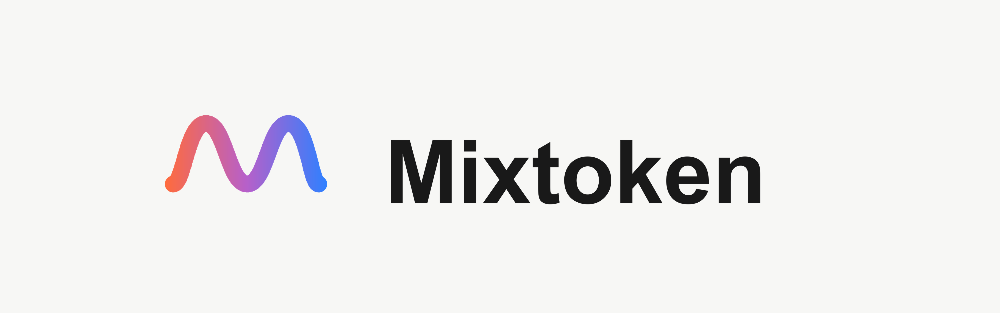</a></td>
    <td valign="middle">❤️ Oh My PPT をご支援いただいている <b><a href="https://mixtoken.ai/?code=GWZQRH">Mixtoken</a></b> に感謝します！<br/>主要な AI モデルの API にワンストップで接続でき、テキスト生成、画像制作、動画制作をカバーしています。1 つの Key ですべてのモデルを呼び出せます！安定・高速で、水増しなし！<br/>🧠 言語モデル：Claude、GPT、Gemini、DeepSeek など。文章作成、コード開発、プレゼン資料の内容生成に対応しています。<br/>🖼️ 画像モデル：GPT-Image、Gemini など。画像の生成と編集に対応しています。<br/>🎥 動画モデル：Seedance、MiniMax Hailuo H3、Grok など。動画生成に対応しています。<br/>✨ 新規ユーザー向け体験：<a href="https://mixtoken.ai/?code=GWZQRH">専用リンク</a>から登録するとお試しクレジットがもらえ、モデルの効果を試せます。接続や利用中に問題があれば、有人のカスタマーサポートに問い合わせできます。<br/>🌐 企業運営：海外企業が運営しており、企業としての資格を持ち、正規の請求書（発票）の発行に対応しています。</td>
  </tr>
</table>

<a id="sponsors"></a>
## 💖 支援者

Oh My PPT を支援してくださったすべての皆さんに感謝します — 全リストは [SponsorsList.md](./SponsorsList.md) をご覧ください。

---

<div>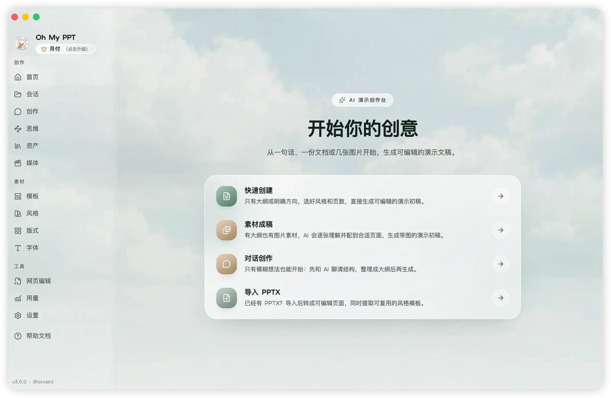</div>

## 目次

- [スポンサー](#sponsors-list)
- [支援者](#sponsors)
- [v3.0 の新機能](#v3)
- [なぜ作ったのか](#why)
- [既存の PPTX テンプレートをインポートして編集](#pptx-import)
- [デスクトップアプリから編集可能な PPTX をエクスポート](#pptx-export)
- [できること](#features)
- [ワークフロー](#workflow)
- [100 以上の組み込みスタイルとスタイル管理](#style-skills)
- [AI 画像生成とスマートビジュアル](#image-generation)
- [フォント管理](#fonts)
- [アニメーション対応](#animations)
- [ローカルの Ollama 対応](#ollama)
- [使用上の注意](#usage-notes)
  - [まずモデルを設定する](#config)
  - [プレビューモードについて](#preview)
  - [エクスポートについて](#export)
- [署名されていないアプリを開く](#unsigned-app)
- [参考](#references)
- [コントリビューター](#contributors)
- [ライセンス](#license)

---

<a id="v3"></a>
## 🚀 v3.0 の新機能

作り直されたワークスペース、176 の再利用可能なレイアウト、スタイル管理、素材からのデッキ作成、そしてメディアワークスペース — すべてがそろいました。レイアウト、スタイル、素材、メディアが 1 つのワークスペースにまとまっています。

|  | 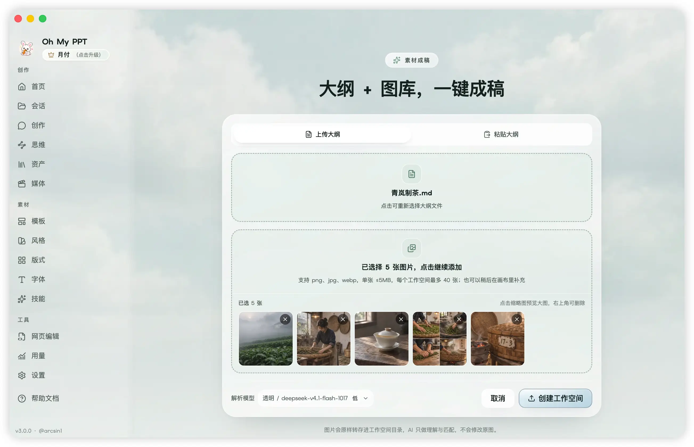 |
| --- | --- |
| **🪟 新しいスタート画面** — クイック作成、素材からデッキ作成、チャットでの作成、PPTX のインポート — 4 つの入口が 1 か所にそろっています。 | **🖼️ 素材からデッキ作成** — アウトラインと画像素材をアップロードすると、AI が各ページを読み取り、画像入りの初稿を作成します。 |
| 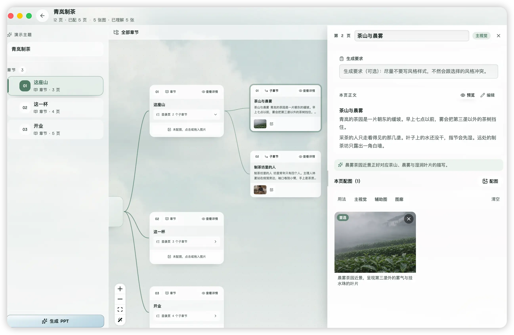 | 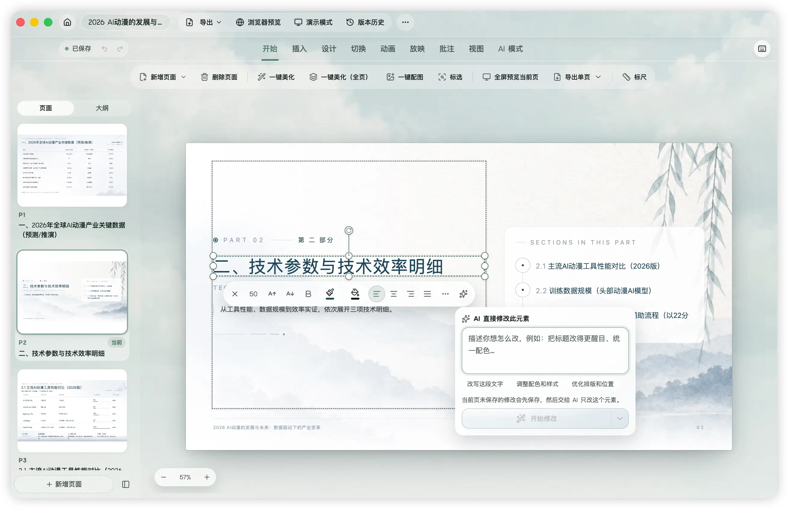 |
| **🗺️ アウトラインとビジュアル** — 章のアウトライン、元資料、ページごとの画像の割り当てを並べて表示します。 | **✨ ビジュアル編集** — 任意の要素を選択し、AI にその場で文章、色、レイアウトを書き換えてもらえます。 |
| 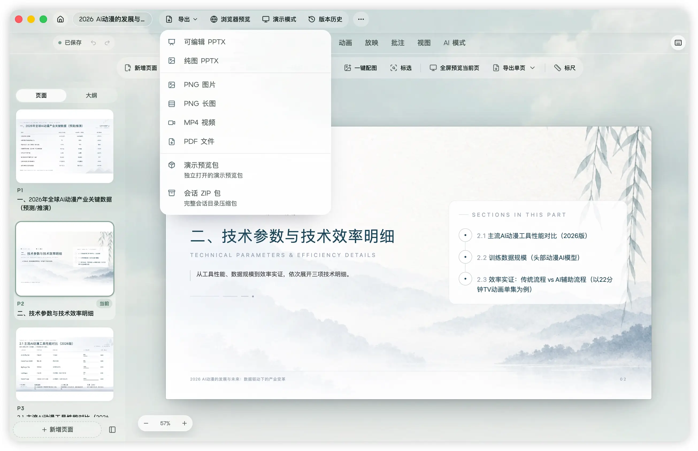 | 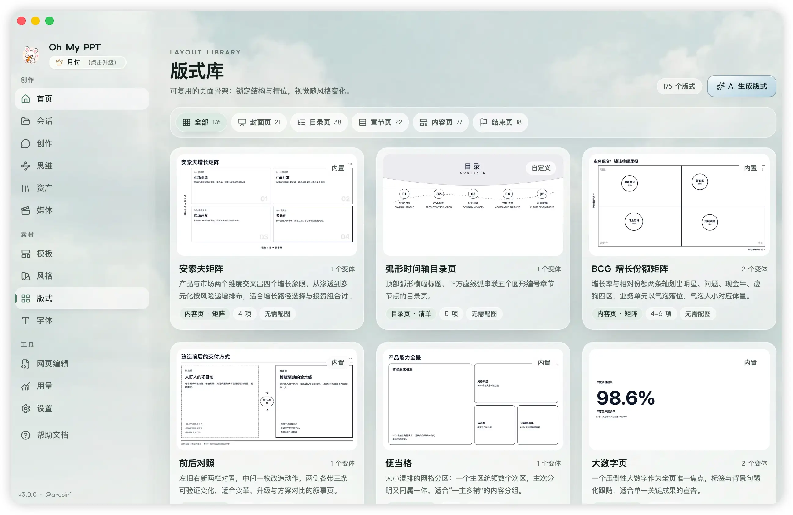 |
| **📤 多形式エクスポート** — 編集可能な PPTX、画像ベースの PPTX、PNG、MP4、PDF を 1 つのメニューから出力できます。 | **🧱 レイアウトライブラリ** — 176 の再利用可能なページの骨組みを、表紙、目次、セクション、本文、締めくくりで絞り込めます。 |
| 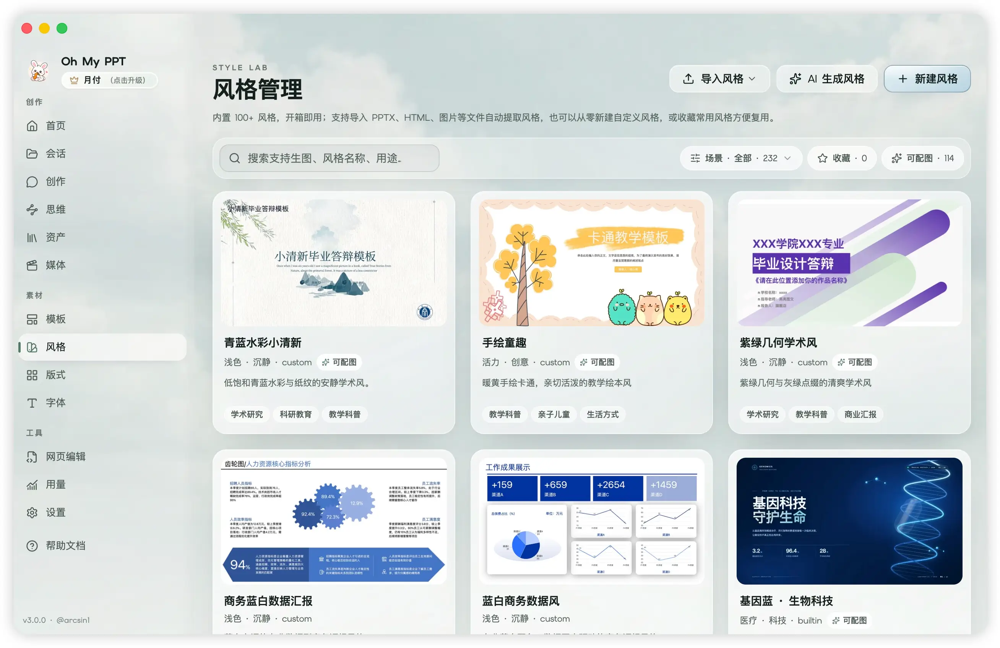 | 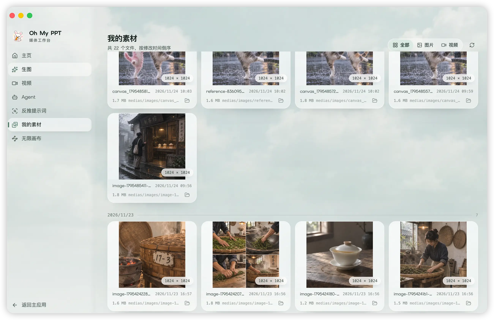 |
| **🎨 スタイルマネージャー** — 100 以上の組み込みスタイル。PPTX、HTML、画像から新しいスタイルを抽出し、繰り返し使うものはお気に入りに登録できます。 | **📽️ メディアワークスペース** — 生成した画像、動画、素材を 1 か所に整理し、すぐに再利用できます。 |

<a id="why"></a>
## 🎯 なぜ作ったのか

**AI による HTML プレゼンテーションを実現するために。**

講演、報告、ピッチ、論文審査などの準備をするたびに、時間の大半はレイアウトの調整に費やされていました。

AI PPT ツールはたくさんありますが、その多くは固定形式のファイルを出力します。スタイルの微調整や独自のアニメーションデモの追加は、今でも面倒です。

そこで、もともとは個人用のツールとして、HTML ベースの PPT ジェネレーターを自作しました。

出力は純粋な HTML スライドです。ブラウザーですぐにプレビューでき、追加のソフトウェアは不要で、スタイルの調整、動きの追加、コードの埋め込みが簡単にでき、PDF / PNG / 編集可能な PPTX にエクスポートできます。

<a id="pptx-import"></a>
## 📥 既存の PPTX テンプレートをインポートして編集、ほぼ 100% の再現度

既存の PPTX テンプレート、過去の報告資料、クライアントのファイルをデスクトップアプリに取り込んで、編集を続けられます。一般的な PPTX のインポートでは、元の見た目と構造をほぼ **100%** 再現し、ドラッグ、調整、AI による変更、バージョン履歴での管理ができるページに変換します。インポートしたファイルから、今後の作業で再利用できるスタイルを取り出すこともできます。

解析と構造化変換は**すべて自社開発**です。複雑な図形、グラフ、表、アニメーションは引き続き改善中で、再現度は元のファイルの機能、フォント、素材の複雑さによって異なります。

<a id="pptx-export"></a>
## 📤 デスクトップアプリから編集可能な PPTX をエクスポート、ほぼ 100% の再現度

デスクトップアプリで作成・編集したあと、PowerPoint / Keynote で編集可能な本物の PPTX をエクスポートできます。一般的なケースでは、エクスポートしたファイルは見た目と構造をほぼ **100%** 保持し、テキスト、画像、色、数式、基本的なレイアウトも可能な限り維持されます。レイアウトを絶対に崩したくない場合は、**画像ベースの PPTX** も利用できます。

HTML から編集可能な PPTX への生成とレイアウトは**すべて自社開発**です。複雑なグラフ、表、図形、アニメーションは引き続き改善中です。

<a id="features"></a>
## ✅ できること

- 🧭 **一新された v3.0 のワークスペース** — スタート画面には、クイック作成、素材からデッキ作成、チャットでの作成、PPTX のインポートの 4 つの入口があります。テンプレート、スタイル、レイアウト、フォント、メディアは 1 つのサイドバーにまとまり、素材、使用統計、HTML 編集もすぐに使えます
- 🖼️ **素材からデッキ作成** — アウトラインと画像素材をまとめてアップロードすると、AI が各画像を読み取り、意味に基づいて適切なページに割り当て、画像入りの初稿を作成します
- 🗺️ **アウトラインとビジュアルを並べて表示** — 章のアウトライン、元資料、ページごとの画像の割り当てを 1 つの画面に配置するので、生成前にすべてのテキストと画像の組み合わせを確認できます
- 🧱 **レイアウトライブラリ** — 176 の再利用可能なページの骨組みを、表紙、目次、セクション、本文、締めくくりで絞り込めます。テキストはそのままに、どのページのレイアウトもワンクリックで入れ替えられます
- 📽️ **メディアワークスペース** — 生成した画像、動画、素材を 1 か所に整理し、すぐに再利用できます
- 🎨 **100 以上の組み込みスタイルとスタイル管理** — Minimal White、Cyber Neon、Bauhaus、Japanese Minimal、Xiaohongshu White など。PPTX、HTML、画像からスタイルを抽出したり、繰り返し使うものをお気に入りに登録したり、独自のスタイルを持ち込んだりできます
- 📥 **既存の PPTX テンプレートをインポートして編集、ほぼ 100% の再現度** — インポートしたファイルは、ドラッグ、調整、AI による変更、バージョン履歴での管理ができるページになります。解析と変換はすべて自社開発です
- 📤 **デスクトップアプリから編集可能な PPTX をエクスポート、ほぼ 100% の再現度** — デッキを PowerPoint / Keynote で編集可能な本物の PPTX ファイルとしてエクスポートできます。生成とレイアウトはすべて自社開発です
- ⚡ **クイック作成** — Markdown / プレーンテキストを貼り付けるか、Word、PDF、Excel ファイルをアップロードします。解析後は章のキャンバスに移り、生成前にスタイル、レイアウト、ページ数を確認できます
- 💬 **チャットでの作成** — 漠然としたアイデアから始められます。テーマ、対象者、構成を AI と話し合い、アウトラインを形にしてから生成します
- 🔀 **複数タスクの生成** — 1 つが終わるのを待たずに複数の生成タスクを並行して送信でき、完了時には自動で通知されます
- 📐 **多様なサイズと形式のキャンバス** — 16:9、4:3、縦長の 9:16、縦向きの 3:4、正方形の 1:1、小紅書（Xiaohongshu）/ SNS ノート形式などに対応し、生成からエクスポートまで実際のアスペクト比を保ちます
- 🌐 **HTML 編集** — 単一の HTML ファイルをインポートしてアプリ内で編集・保存でき、AI による編集、素材の挿入、履歴、プレビュー、エクスポートにも対応しています
- 🧱 **テンプレートライブラリとテンプレート作成** — 生成・編集したデッキをテンプレートとして保存したり、PPTX ファイルをテンプレートとしてインポートしたり、テンプレートを再利用して新しい PPT セッションを作成したりできます
- 🖼️ **AI 画像生成とスマートビジュアル** — デッキの作成時に自動ビジュアルを有効にできます。AI は、すべてのスライドに無理に画像を入れるのではなく、現在の内容、レイアウト、選択したスタイルが必要とする場所にだけ、イラスト、背景、ビジュアル素材を生成します
- ✨ **エディター内の画像スタジオ** — 現在のスライドのタイトルとアウトラインからプロンプトを生成し、独自の指示と画像サイズを加えたうえで、結果をプレビューし、キャンバスに追加するか、スライドの背景に設定できます
- 🔒 **ローカルファースト** — セッション、元資料、素材、生成結果はお使いのコンピューターに保存されます。Oh My PPT のアカウントやプラットフォームのクラウドは不要です。設定した AI や画像サービスへのリクエストは、そのプロバイダーに送信されます
- 🔤 **フォント管理** — 厳選された 14 の Google Fonts（CJK を含む）を内蔵し、ローカルのフォントのアップロード、タイトルと本文のフォントの個別選択、AI による自動マッチングに対応しています
- ✏️ **チャットによる編集** — 特定のページで「タイトルの色を変えて」「データのグラフを追加して」と伝えるだけで、全体を作り直す必要はありません。任意の要素を選択して、その部分だけを AI に変更してもらえます
- 🖱️ **ビジュアル編集** — 表示されているすべての要素はドラッグとサイズ変更ができ、テキストはダブルクリックでその場で編集できます。ツールバーには、ページの挿入 / 削除、ワンクリックでの美化、ワンクリックでのビジュアル追加があります
- 📸 **画像と動画の挿入** — 編集モードで素材ライブラリやローカルファイルから画像や動画を直接アップロードし、AI が生成した画像と一緒に使えます
- 📋 **要素の複製** — 任意の要素（テキスト、画像、動画など）をワンクリックでコピーでき、自動でずらして配置され、個別に編集できます
- ↩️ **元に戻す・やり直す** — 確定する前に編集を自由に元に戻したりやり直したりでき、その後バージョン履歴のエントリとして保存できます
- 🗑️ **要素の削除** — クリックまたはキーボードショートカットで任意の要素を削除できます
- 🖥️ **プレゼンテーションモード** — ワンクリックで全画面のプレゼンテーションに入り、矢印キーまたはクリックでスライドを移動できます
- 📝 **講演原稿の生成** — デッキ全体または現在のスライドの原稿を、フォーマル、カジュアルな会話調、ストーリーテリング、カスタムのスタイルで生成できます
- 🎬 **アニメーション対応** — 16 以上のスライド切り替え効果と 38 種類の要素アニメーション（ローカルの Anime.js v4 ランタイムで動作）に対応し、エクスポートした PPTX でも利用できます
- 🎞️ **要素ごとのアニメーション設定** — 編集中に個々のテキスト、画像、グラフなどの要素を選択し、開始、強調、終了の効果を、自動 / クリックのトリガー、再生時間、方向とともに設定できます
- 🧮 **数式のレンダリング** — 授業、教材、技術講演向けに、一般的な LaTeX の数式を表示できます
- 📄 **多形式エクスポート** — 編集可能な PPTX、画像ベースの PPTX、PNG、PNG の縦長画像、PDF、MP4 を 1 つのメニューから出力できるほか、セッションの ZIP バックアップや単独で使えるプレゼンテーションのプレビューパッケージにも対応しています
- 🏷️ **セッション管理** — セッション一覧では AI で作成したデッキとインポートした PPTX のデッキを区別でき、デッキ名を変更できます。セッションは開く前にヘルスチェックされるので、空白のページが表示されることはもうありません
- 🧩 **より信頼性の高いページレイアウト** — 生成時に選択したキャンバスサイズとコンテンツの高さの上限に従い、はみ出しを減らします
- 🔄 **バージョン履歴のロールバック** — すべての編集は自動で保存され、ワンクリックで以前の任意のバージョンに戻せるので、失敗を心配する必要はありません
- 📊 **使用統計** — 各生成と編集のステップごとに Token の消費量が明確にわかります
- 💾 **セッションのインポートとエクスポート** — エディターからセッションの ZIP をエクスポートし、別のコンピューターでインポートして編集を続けられます。プレゼンテーションのプレビューパッケージはダブルクリックでブラウザーで開けるので、デバイス間でシームレスに共同作業できます

<p>
  
  
  
</p>

<a id="workflow"></a>
## 🔄 ワークフロー

> 💡 モデルを設定したら、4 つの作成の入口から 1 つを選ぶ → 章のアウトライン、スタイル、レイアウト、ページ数を確認する（素材からデッキ作成では画像のアップロードも行います）→ AI が編集可能な HTML スライドをページごとに生成する → プレビュー、プレゼンテーション、ビジュアル編集、チャットで仕上げる → ほぼ 100% の再現度で編集可能な PPTX、または画像ベースの PPTX / PDF / PNG / MP4 / セッションの ZIP をエクスポートする。


ホームページには 4 つの作成の入口があります。手元にあるものに合わせて選んでください：

- **クイック作成**（アウトラインや明確な方向性がある場合）：Markdown / プレーンテキストを貼り付けるか、Word、PDF、Excel ファイルをアップロードします。解析後は章のキャンバスに移り、生成前にスタイル、レイアウト、ページ数を確認できます。
- **素材からデッキ作成**（アウトラインと画像がある場合）：アウトラインと画像素材をまとめてアップロードすると、AI が各画像を読み取り、意味に基づいて適切なページに割り当て、画像入りの初稿を作成します。ワークスペースでは、各画像がどのように理解されたかを確認し、テキストと画像の組み合わせを微調整できます。
- **チャットでの作成**（アイデアだけがある場合）：まずテーマ、対象者、構成を AI と話し合い、アウトラインを形にしてから生成します。要件がまだはっきりしない場合、資料が複雑な場合、まず一緒にアウトラインを練りたい場合に便利です。
- **PPTX のインポート**（既にファイルがある場合）：既存の PPTX ファイルを編集可能なページに変換し、同時にそのスタイルとレイアウトを抽出します。ほぼ 100% の再現度で復元されるので、そのまま編集を続けられます。

保存したテンプレート、スタイル、レイアウト、フォントは、どれも新しい作業で再利用できます。生成中にページを離れても、タスクはバックグラウンドで続行され、完了すると通知されます。生成後は、エディターで編集を続け（要素のドラッグ、画像 / 動画の挿入、チャットによる編集、履歴のロールバック、講演原稿の生成）、ほぼ 100% の再現度で編集可能な PPTX やその他の形式でエクスポートできます。

<a id="style-skills"></a>
## 🎨 100 以上の組み込みスタイルとスタイル管理

Minimal White、Cyber Neon、Bauhaus、Japanese Minimal、Xiaohongshu White など、100 以上のスタイルが組み込まれており、よく使うものはお気に入りに登録できます。v3.0 からは、PPTX、HTML、画像からスタイルを抽出して独自のライブラリを作れます。スクリーンショットやデザインのモックアップをアップロードし、AI にその視覚的な特徴を抽出させて、個性的なスタイルとアウトラインを作ることもできます（マルチモーダル AI モデルが必要です）。

独自の Style Skill を作成するには、公式のスタイル生成パッケージ [arcsin1/style-generate-skill](https://github.com/arcsin1/style-generate-skill) を使ってください。参考デザイン、カラーパレット、レイアウトの要件を、インポート可能な Oh My PPT のスタイルパッケージに変換するのに役立ちます。


<a id="image-generation"></a>
## 🖼️ AI 画像生成とスマートビジュアル

画像生成には、デッキ全体のビジュアル用と、ピンポイントでの追加用の 2 つの入口があります：

| 用途 | 使い方 | 結果 |
| --- | --- | --- |
| デッキ全体を作成する | **Settings → Image Models** で画像のエンドポイントを追加して**画像のテスト生成**を行い、作成ページで **Image Generation** を有効にして、**Image generation** と表示されたスタイルを選びます | AI は適したレイアウトの枠にだけイラスト、背景、ビジュアル要素を作成し、テキスト用のスペースと選択したビジュアルスタイルを保ちます |
| 既存のスライドを編集する | エディターの画像生成パネルを開き、現在のスライドからプロンプトを生成するか自分で書いてから、モデルとサイズを選びます | 生成した画像をプレビューし、キャンバスに追加してレイアウトを調整するか、現在のスライドの背景に設定します |

組み込みのプロバイダーのプリセットには、Jimeng 3.0 / 4.0、Agnes AI、Seedream、SiliconFlow、Gemini、OpenAI 互換の画像 API があります。テキストモデルと画像モデルは別々に設定し、画像のエンドポイントは **Settings → Image Models** で実際のテストに合格して初めて使えるようになります。

生成に成功した出力は、メディアワークスペースとセッションのローカル素材ディレクトリに保存され、編集、置き換え、エクスポート、セッションとの移動ができます。自動ビジュアルはキャンバスの形式を保ち、アップロードした画像を置き換えることはありません。画像のリクエストは選択したプロバイダーに送信されます — そのプライバシーおよびコンテンツのポリシーに従ってください。

<a id="fonts"></a>
## 🔤 フォント管理

厳選された 14 の Google Fonts（CJK のファミリーを含む）が組み込まれています。ローカルの `.woff2` フォントファイルをアップロードし、フォント名、カテゴリー（サンセリフ、セリフ、手書き、等幅など）、役割（タイトル / 本文）、文字の種類（ラテン / CJK）をカスタマイズすることもできます。

デッキの作成時には、**タイトルのフォント**と**本文のフォント**を別々に選ぶか、テーマとスタイルに基づいて AI に最適なフォントの組み合わせを自動で選ばせることができます。PPTX にエクスポートする際は、使用したフォントが自動で埋め込まれるので、ほかのコンピューターでもデッキが同じように表示されます。

<a id="animations"></a>
## 🎬 アニメーション対応

Oh My PPT は、16 以上のスライド切り替え効果、38 種類の要素アニメーション、ローカルの **Anime.js v4** ランタイムを備えた HTML スライドを生成します — アニメーションはエクスポートした PPTX でも利用できます。生成中やチャットによる編集中に、AI はタイトル、指標カード、画像、グラフのコンテナ、ステップのブロックなど、スライドの要素全体にプレゼンテーション用の動きを加えられます。

AI が生成する動きに加えて、編集モードでは個々の要素を選択し、開始、強調、終了の効果を、自動またはクリックのトリガー、再生時間、方向とともに設定できます。

アニメーションは実際のプレゼンテーションの流れに合わせて設計されています。スライドの内容を一度にすべて表示するのではなく、話し手のリズムに合わせて少しずつ表示できます。報告、ピッチ、授業、製品のウォークスルーに適しています。

よく使われるアニメーション表現には次のようなものがあります：

- **フェードイン**：モジュールが表示されるときの軽いトランジション。
- **スライドイン**：タイトル、カード、リストを上下左右から短く動かします。
- **拡大による強調**：重要な数値や結論のカードを少し拡大してから元に戻します。
- **段階的な表示**：カードや箇条書きを 1 つずつ順番に表示します。
- **クリックで表示**：プレゼンテーション中に内容を段階的に表示し、デッキが話すペースについてくるようにします。

テキストを細かい動く断片に分けるよりも、要素全体のアニメーションが推奨されます。そのほうがスライドが読みやすく安定し、後でエクスポートや編集もしやすくなります。アニメーションは注意を導き、階層を示すためのものなので、複雑なタイムライン、頻繁な点滅、無限ループ、大きな揺れる動きはおすすめしません。

<p>
  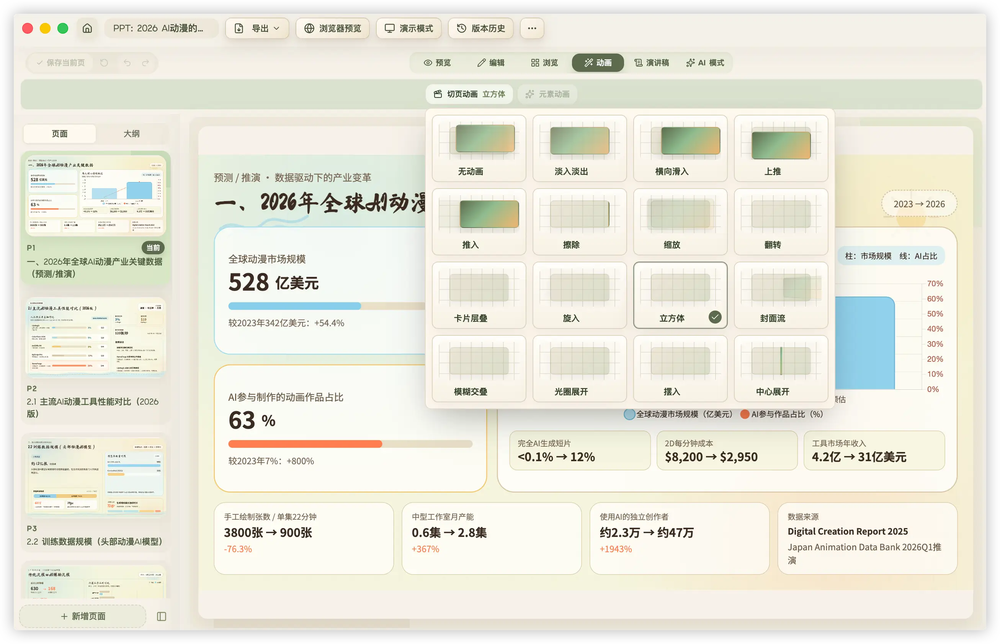
  
</p>

<a id="ollama"></a>
## 🦙 ローカルの Ollama 対応（OpenAI 互換）

このプロジェクトは、**OpenAI 互換の API** を通じてローカルの Ollama に対応しています。

**Settings → Base Model Configuration** でエンドポイントを追加する際は、次のように入力してください：

- `Provider preset`：`OpenAI Compatible`
- `base_url`：`http://127.0.0.1:11434/v1`
- `Model`：ローカルのモデルタグを手動で入力します（例：`qwen2.5-coder:14b`）。14B 以上のモデル（または高性能なクラウドモデル）を推奨します
- `api_key`：空でない任意の文字列（例：`ollama`）

注意：

- Ollama はデフォルトでは API キーを検証しませんが、このアプリでは空でないことをチェックするため、`api_key` を空欄にすることはできません。
- 安定した生成品質のために、14B 以上のローカルモデル（または高性能なクラウドモデル）を推奨します。
- 公式の OpenAI のエンドポイントには非標準の `thinking` パラメーターを送信しないため、`400 Unknown parameter` のレスポンスを回避できます。その他の OpenAI 互換の `base_url` では、マルチターンのツールフローで `reasoning_content` が失われないよう、引き続き thinking の無効化をリクエストします。
- Ollama の設定は、テキスト生成、ドキュメントの解析、チャットによる編集用です。画像生成や自動ビジュアルを使うには、**Settings → Image Models** で画像に対応したプロバイダーを別途設定してください。

<a id="usage-notes"></a>
## 使用上の注意

<a id="config"></a>
### まずモデルを設定する

> 推奨：DeepSeek V4、Kimi、Doubao、Qwen、GLM、MiMo、MiniMax などの中国のモデル、および GPT、Claude などの海外のモデル。

**Settings → Base Model Configuration** で **Add Endpoint** をクリックし、プロバイダーのプリセットを選び（該当するものがなければ **Custom / Compatible Protocol**）、base_url と API キーを入力して保存します。次に、モデル一覧でモデルを取得するか手動で追加します — 最初のエンドポイントの最初のモデルが自動でデフォルトになります。生成、チャットによる編集、ドキュメントの解析はすべて、ここで設定したベースモデルを使います。一度設定すれば、必要に応じていつでもモデルを切り替えられます。

AI 画像生成や自動ビジュアルを使うには、**Settings → Image Models** で画像のエンドポイントを追加し、各モデルで画像のテスト生成を行ってください。テストに合格すると、作成ページでビジュアルを有効にしたり、エディターやメディアワークスペースで使ったりできます。

<a id="preview"></a>
### プレビューモードについて

左右の矢印キーでスライドを移動できます。プレゼンテーションモードと全画面のプレゼンテーションモードの両方に対応しており、`ESC` でプレゼンテーションを終了します。

<a id="export"></a>
### エクスポートについて

すべて 1 つのメニューからエクスポートできます：

- **編集可能な PPTX**：すべて自社開発のエクスポート基盤で、一般的なケースではほぼ 100% の再現度があり、PowerPoint / Keynote で編集可能です — 納品やさらなる仕上げに最適です。
- **画像ベースの PPTX / PNG**：レイアウトが崩れないので、共有、SNS への投稿、アーカイブに最適です。PNG はすべてのスライドを一括でエクスポートでき、ドキュメント、Notion、記事、SNS のコンテンツに使えます。
- **PNG の縦長画像**：すべてのページを縦につなげて 1 枚の長い画像にし、SNS への投稿、チャットでの共有、長いドキュメントのプレビュー、モバイルでの閲覧に使えます。
- **PDF**：共有、アーカイブ、印刷に最適です。
- **MP4**：アニメーション付きのページを動画にレンダリングし、講座、再生、PPT ファイルが最適でない場面で使えます。
- **セッションの ZIP / プレゼンテーションのプレビューパッケージ**：完全なバックアップやデバイス間の移行に使えます。プレビューパッケージはダブルクリックでブラウザーで開いてプレゼンテーションでき、インストールは不要です。


<a id="unsigned-app"></a>
## 📦 署名されていないアプリを開く

リリースビルドはまだコード署名されていない場合があるため、初回起動時に macOS や Windows がセキュリティ警告を表示することがあります。通常、これはアプリが壊れているという意味ではなく、オペレーティングシステムが署名されていない、または公証されていないソフトウェアをデフォルトでブロックしているためです。

### macOS

アプリを開けない、壊れている、または開発元を検証できないと macOS に表示された場合は、次のいずれかの方法を使ってください。

**方法 1：右クリックして開く**

1. Finder またはアプリケーションフォルダーを開きます。
2. `OhMyPPT.app` を見つけます。
3. アプリを右クリックして **開く** を選びます。
4. 確認ダイアログでもう一度 **開く** をクリックします。

通常、この操作は一度だけで済みます。

**方法 2：隔離属性を削除する**

右クリックして開いてもうまくいかない場合は、次を実行してください：

```bash
xattr -cr /Applications/OhMyPPT.app
```

その後、もう一度アプリを開いてください。

アプリを別の場所に置いた場合は、パスを実際の場所に置き換えてください。例：

```bash
xattr -cr ~/Downloads/OhMyPPT.app
```

### Windows

署名されていないインストーラーでは、「Windows によって PC が保護されました」のような Windows SmartScreen の警告が表示されることがあります。これは署名されていないアプリでは想定どおりの動作です。

手順：

1. **詳細情報** をクリックします。
2. アプリ名が `OhMyPPT` であることを確認します。
3. **実行** をクリックします。

ブラウザーやウイルス対策ソフトがファイルをブロックした場合は、まずインストーラーがこのプロジェクトの GitHub Releases ページから入手したものであることを確認してから、ファイルを保持または許可してください。

> できる限り、公式の Releases ページからのみビルドをダウンロードしてください。

<a id="references"></a>
## 参考

- [@arcsin1/pptx2json](https://www.npmjs.com/package/@arcsin1/pptx2json) — Oh My PPT の編集可能な PPTX インポートのための、すべて自社開発の基盤で、PPTX ファイルを編集可能な構造化データに解析します。複雑な図形、グラフ、表、アニメーションなどへの対応は引き続き改善されます。
- [@arcsin1/html2pptx](https://www.npmjs.com/package/@arcsin1/html2pptx) — Oh My PPT の編集可能な PPTX エクスポートのための、すべて自社開発の基盤で、HTML を本物の編集可能な PPTX ファイルに変換します。複雑な図形、グラフ、表、アニメーションなどへの対応は引き続き改善されます。
- [arcsin1/style-generate-skill](https://github.com/arcsin1/style-generate-skill) — 参考デザイン、カラーパレット、レイアウト、シナリオの要件を、インポート可能なスタイルパッケージに変換するための、Oh My PPT 公式のスタイル生成 Skill です。
- [ui-ux-pro-max-skill](https://github.com/nextlevelbuilder/ui-ux-pro-max-skill)
- [html-ppt-skill](https://github.com/lewislulu/html-ppt-skill)

<a id="contributors"></a>
## コントリビューター

すべてのコントリビューターに感謝します！

<p>
<a href="https://github.com/m13891290332"></a>
<a href="https://github.com/whisper-xiang"></a>
<a href="https://github.com/Jacobinwwey"></a>
</p>

<a id="license"></a>
## ライセンス

このプロジェクトは [Apache License 2.0](LICENSE) の下でライセンスされています © 2026 arcsin1 &lt;zy19931129@gmail.com&gt;。
